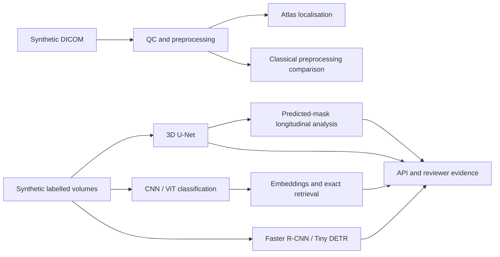

# Enterprise Medical Imaging AI Platform

## Project Summary

A governed research platform for synthetic abdominal CT engineering: ingestion and QC,
supervised models, model comparisons, exact retrieval, longitudinal measurements and review evidence.
M23 consolidates the existing M1–M22 capabilities; it adds no model family or external dataset.

This platform is a research and engineering demonstrator. Outputs are intended for technical evaluation and human review only and must not be used for clinical diagnosis or patient-management decisions.

## Problem Statement

Imaging models need reproducible data contracts, traceable artifacts, meaningful failure handling
and accountable review. This repository demonstrates those engineering boundaries on synthetic data.

## Architecture Overview



The branches are explicit: model datasets use synthetic reference annotations; localisation ROIs
are not their training inputs. [Architecture](docs/architecture/final_end_to_end_architecture.md).

## Implemented Capabilities

- Local DICOM discovery, ordering, metadata de-identification, QC and CT preprocessing.
- Rigid/affine registration, atlas-style adrenal-region localisation and classical QC comparisons.
- Synthetic 3D segmentation, calibrated classification and CNN/ViT benchmarks.
- Axial Faster R-CNN/Tiny DETR detection and benchmark evidence.
- CNN/ViT embeddings, deterministic exact retrieval and retrieval benchmarks.
- Mask-based longitudinal measurements, governed API, reviewer visualisation and artifact-bound decisions.
- Checksummed evidence, manual model lifecycle, deployment design and operations simulations.

## End-To-End Workflow

`make platform-demo` runs a bounded CPU workflow using existing generators and models. It trains
one epoch, exports predictions, benchmarks, API review responses and a validated evidence index.
Longitudinal inputs are actual predicted masks. Classification/detection labels come from reference
masks. DICOM fixtures form a separate preprocessing branch. [Demo details](docs/platform_demo.md).

## Technology Stack

Python 3.12+, NumPy, pydicom, SimpleITK, PyTorch, MONAI, torchvision, FastAPI and Streamlit.
Quality checks use pytest/branch coverage, Ruff, strict mypy and Bandit.

## Security And Governance

Inputs stay under explicit local roots; uploads are bounded and pickle loading is disabled.
Reviewer decisions preserve model outputs and record artifact identity/checksums where available.
No authentication, PACS or clinical integration is implemented. [Security](docs/security.md),
[human oversight](governance/human_oversight.md), [evidence contracts](docs/evidence_contracts.md).

## MLOps And Monitoring

Model approval remains manual. Registry, drift and incident workflows produce engineering evidence;
they do not automatically retrain, promote or roll back models. [Operations](docs/operations/observability.md).

## Deployment Assurance

Containers and Helm have policy checks and optional local execution. Generated evidence states
whether checks were actually executed or only statically validated.

## AWS Target-State Boundary

Terraform describes an AWS target state. No AWS resources or live cloud deployment are implied.
[Deployment architecture](docs/deployment/aws_architecture.md).

## Quick Start

From the repository root:

```bash
python3 -m pip install -r requirements/ci-quality.txt
make quality
make platform-demo
```

Both `python3 -m medical_imaging_platform --help` and `medical-imaging-platform --help` expose the
same command registry, including embeddings. [Local API/UI startup](docs/local_startup.md).

## Demo Commands

```bash
make platform-demo
# Use a new destination for a repeat run; existing evidence is protected.
make platform-demo PLATFORM_DEMO_DIR=/tmp/platform-demo-repeat
make portfolio-readiness
```

`make demo-fast` retains the earlier assurance-only workflow. `make demo` retains the older module
verification workflow. Neither should be confused with the M23 prediction-driven demonstration.

## Evidence Locations

The canonical run writes ignored artifacts under `reports/generated/platform-demo/`:

- `evidence_index.json`: run references, file checksums, roles and capability status.
- `engineering_comparison.md` / `.json`: measured classification, detection and retrieval comparisons.
- `reviewer_segmentation.json`, `reviewer_search.json`, `reviews/`: API evidence and separate decisions.
- `config/`: explicit local API/UI/model configurations referencing generated checkpoints/indexes.

[Comparison guide](docs/engineering_comparison.md), [technical evidence overview](docs/portfolio/project_summary.md).

## Test And Quality Status

`make quality` runs formatting, lint, strict typing, configuration/docs validation, tests and Bandit.
Repository branch coverage must remain at least 90%. Use the current command output and
`coverage.xml`; historical test counts are not a current readiness claim.

## Limitations

Synthetic fixtures do not establish clinical performance. Localisation is an atlas placeholder;
segmentation smoke gates are permissive engineering checks; detection is 2D; similarity is not
diagnostic similarity. Empty predictions and failed quality findings remain visible.
No mask editing, promptable model, foundation model, external dataset or new ML framework is added.
Capability labels distinguish **implemented**, **executed/validated**, **simulated**, **static design**
and **target state**. [Limitations](docs/limitations.md).

## Attribution

Third-party licenses and citations are recorded in [NOTICE.md](NOTICE.md) and
[attribution](docs/attribution.md). Model weights and generated fixtures are not source artifacts.
