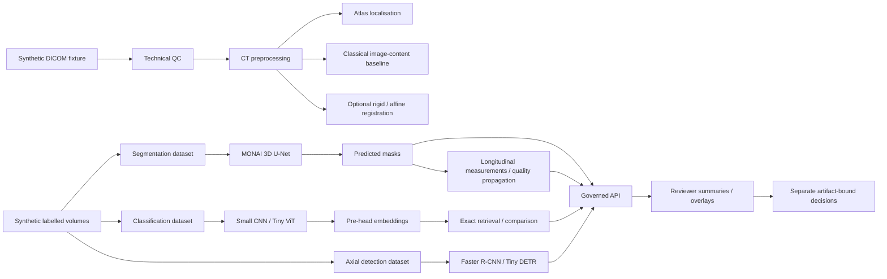

# Consolidated platform architecture through M23

This platform is a research and engineering demonstrator. Outputs are intended for technical
evaluation and human review only and must not be used for clinical diagnosis or patient-management
decisions.

M1–M22 supply the task families; M23 consolidates interfaces, evidence and demonstration. The
architecture separates actual data dependencies from optional integration and target-state designs.

## Status Legend

| Label | Meaning |
|---|---|
| Implemented | Source and tests exist |
| Executed/validated | A named run/check supplies evidence and context |
| Simulated | Local engineering scenario, not a live operational incident |
| Static design | Configuration or infrastructure validated without a deployed workload |
| Target state | Designed operational architecture, not deployed |

Legacy portfolio `claim_classification` values remain readable. Its added `capability_status` maps
locally executed to executed/validated, statically validated to static design, and target-state only
to target state. PASS/WARN/FAIL are check outcomes, not maturity labels.

## End-To-End Flow

The canonical demonstration does not train from DICOM/localisation ROIs. Model datasets use the
existing synthetic reference annotations. Classification may repair splits to retain both labels;
its own manifest is authoritative. Detection boxes are reference-derived. Longitudinal demonstration
uses actual predicted masks and preserves missing-registration quality failures. Earlier verification
commands using reference masks remain labelled separately. No upstream status is invented to make
quality green.

## Component Architecture

The common CLI registers arguments once. Module, installed executable and legacy embeddings wrapper
call the same entry point. Domain modules retain their validators; common evidence sidecars add
cross-module identity and hashes without replacing existing contracts.

The API bounds local inputs and exposes readiness, prediction summaries, segmentation slice previews
and configured embedding-index choices. Reviewer UI performs no inference: it submits requests,
checks source/preview compatibility, displays provenance and records separate human-review decisions.

M20 classification and M21 detection compare both supported families under their own shared policies.
M22 retrieval uses one relevance/gallery/query/exclusion policy across evaluation and benchmarks,
with stored-matrix validation before search. Exact search is deterministic for equal scores.

## Model Lifecycle

Training produces candidates and evidence, never deployment approval. Manual registry approval is
separate from model accuracy, service readiness and review acceptance. Original prediction artifacts
remain unchanged when review decisions are exported. Foundation models and prompt editing are outside
M23 scope.

## Deployment Architecture

Containers supply non-root/local runtime assurance. Helm/Kubernetes support static checks and optional
local execution. Terraform describes AWS ECR/EKS/S3/KMS/monitoring target state; it does not apply
resources. The CPU demo does not prove a live Kubernetes or AWS deployment.

## Monitoring And Audit Flow

Model/data/evidence provenance → quality findings → reviewer interpretation → separate decision.
Operations incidents, drift and rollback scenarios remain simulated. No automatic promotion,
retraining or rollback occurs. [Evidence contract](../evidence_contracts.md),
[canonical demo](../platform_demo.md), [local startup](../local_startup.md).

## Security Boundaries

Synthetic/public de-identified research scope only; no PACS or patient-management integration.
Explicit input/evidence roots, size limits, no NumPy pickle, checksummed artifacts, visible unavailable
capabilities and research-only warnings. Authenticated audit storage and clinical validation remain
outside this local demonstrator.
